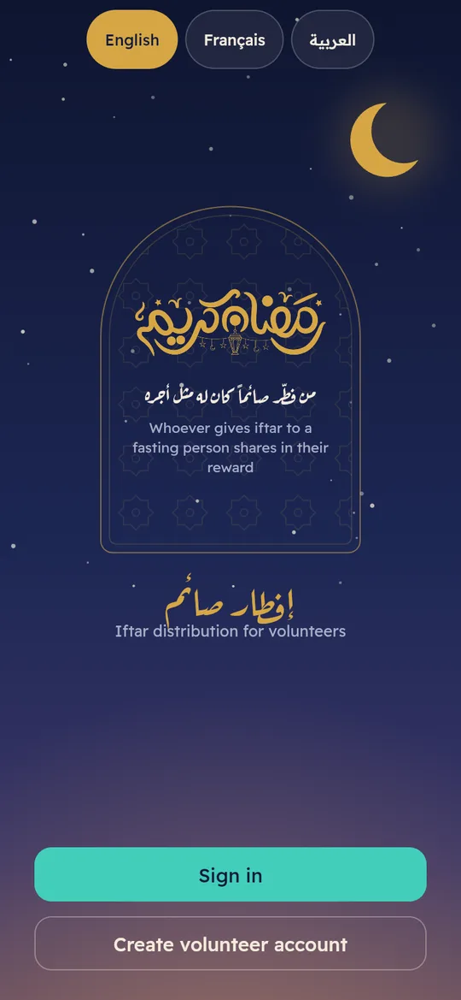
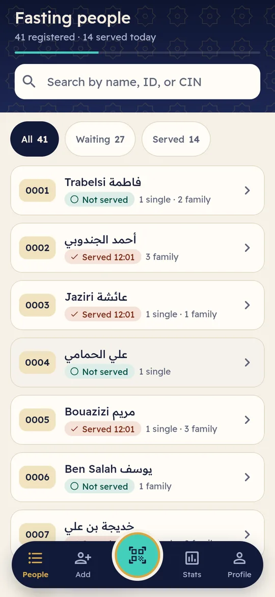
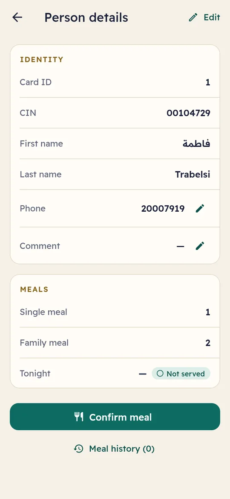
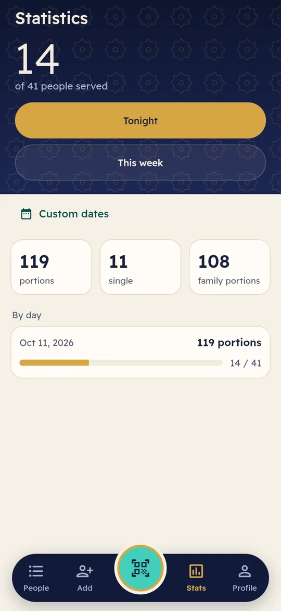
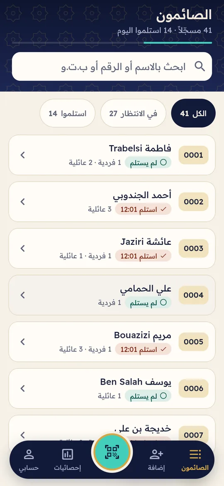
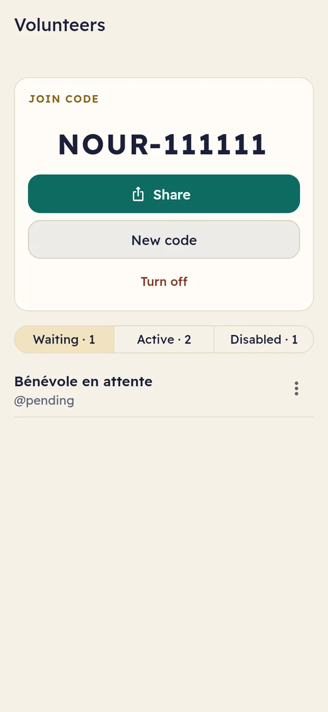
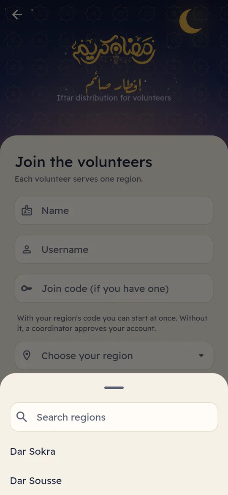
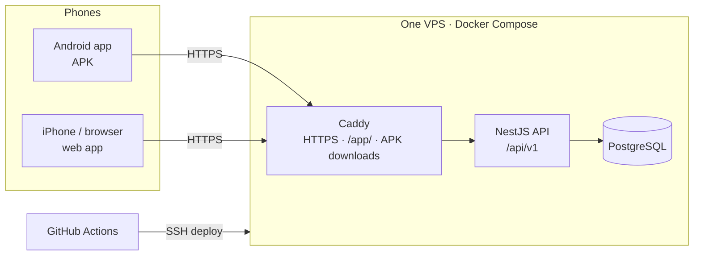

<div align="center">

# إفطار صائم — Iftar Saim

**Free app for running a Ramadan iftar distribution.**
Volunteers scan a person's QR card, see how many meals to hand over, and confirm.
The server makes sure nobody is served twice in one night, even when several phones scan the same card.


[](LICENSE)

&nbsp;
&nbsp;
&nbsp;


</div>

## Why

Charities that hand out iftar meals during Ramadan usually track who has been
served on paper or in a shared spreadsheet. On a busy evening, with several
volunteers at several tables, that breaks down: people get served twice,
others are missed, and nobody knows the totals until the end. Iftar Saim
replaces the list with a phone app that every volunteer uses at the same
time.

## Features

- **Scan and serve.** Each registered person gets a card with a QR code. A
  scan shows their name, ID number, and how many single and family meals to
  hand over. One tap confirms.
- **One meal per person per night, guaranteed by the server.** Simultaneous
  scans of the same card on two phones cannot both succeed. A volunteer can
  undo their own confirmation for a few minutes.
- **Works with a bad connection.** Retries never record a second meal. If the
  coordinator allows it, volunteers can keep serving offline and the phone
  syncs later.
- **Regions and roles.** Each region (a distribution point) has its own list,
  volunteers and coordinator. Volunteers join with a region code or wait for
  approval. Three roles: volunteer, region coordinator, administrator.
  Administrators add new regions from the app (Profile → Team → New region).
- **Live statistics.** Portions served tonight, this week or for any dates,
  per region, plus each person's meal history.
- **Three languages, right-to-left included.** English, French and Arabic.
- **Android, iPhone and web from one Flutter codebase.** Android gets an APK
  with in-app updates; iPhones use the same app as a web app.
- **Excel export** of the list of people.
- **Cheap to host.** One small VPS with Docker Compose, HTTPS included. Easy
  to set up again each Ramadan.

<div align="center">

&nbsp;
&nbsp;


</div>

## How it works



The API is the only source of truth for "served tonight": it records each
meal as an event, and a unique constraint per person per day rejects
duplicates with `409 MEAL_ALREADY_TAKEN`. "Tonight" follows the
`APP_TIMEZONE` setting. Deployment, releases and updates are described in
[docs/DEPLOYMENT.md](docs/DEPLOYMENT.md).

## Use it for your organization

1. **Try it locally** with the quick start below. It comes with test regions,
   volunteers and 55 fictional people.
2. **Set up your regions** (an administrator adds them from the app under
   Profile → Team → New region) and set the timezone (`APP_TIMEZONE`) for
   your city.
3. **Deploy** to a small VPS by following
   [docs/DEPLOYMENT.md](docs/DEPLOYMENT.md): set a few GitHub settings, run
   one workflow, and send volunteers the `/download` link.

Questions, bugs or ideas: [open an issue](https://github.com/badrbenfraj/iftar-ramadhan/issues).

## Quick start

You need only **Docker Desktop** and **Git** (on Windows, run the commands in
Git Bash). Full guide: **[docs/LOCAL_DEVELOPMENT.md](docs/LOCAL_DEVELOPMENT.md)**.

```bash
git clone https://github.com/badrbenfraj/iftar-ramadhan.git
cd iftar-ramadhan
deploy/local/up.sh        # Postgres + API + seed data + web app (first run ~10 min)
```

Then open the address it prints, `https://<your-LAN-IP>:8443/app/`, on this
computer or a phone on the same Wi-Fi (accept the certificate warning once),
and sign in as `admin` / `admin-test-pass` or `vol1` / `test-pass`.

| Next | Command |
|---|---|
| Rebuild the web app after Flutter changes | `deploy/local/up.sh --build-web` |
| Android APK for this stack | `API_URL=http://<LAN-IP>:3300 apps/mobile/tool/build-apk.sh local` |
| Stop (data is kept) | `deploy/local/up.sh down` |

## Monorepo layout

```
/
├── apps/
│   ├── mobile/          Flutter app (Android + iOS): the new client
│   ├── backend/         NestJS 12 REST API + PostgreSQL (TypeORM 1.x)
│   └── legacy-ionic/    Previous Ionic 7 / Angular 16 app (kept until the Flutter app is validated in the field)
├── packages/            Shared Dart packages (none yet, see packages/README.md)
├── docs/
│   ├── LOCAL_DEVELOPMENT.md    New-computer setup, local stack, test data, phones
│   ├── DEPLOYMENT.md           Server, releases, in-app updates, yearly redeployment
│   ├── MIGRATION_ANALYSIS.md   Pre-migration analysis of the Ionic app and the API
│   └── MIGRATION_REPORT.md     What changed, why, what's left
├── deploy/              SSH scripts used by GitHub Actions (or by hand)
├── deploy/local/        Local dev stack (dev only, never deployed): up.sh, compose.yml, seed.sql
├── docker-compose.yml   Production stack: Caddy (TLS + APK files) + API + Postgres + Adminer
└── Caddyfile
```

## Requirements

With the Docker setup above, Docker Desktop and Git are enough. To work
natively instead:

| Tool | Version |
|---|---|
| Flutter | The version in `apps/mobile/.flutter-version` (CI uses the same) |
| Node.js | 24 LTS |
| PostgreSQL | 16 (or Docker) |
| Android | SDK 36 via Android Studio; JDK 17 |
| iOS | Xcode 16+ on macOS |

No local Flutter/Android SDK? Every Flutter command below also runs in Docker,
in the image pinned by `.flutter-version` (built once by `tool/flutter-image.sh`):

```bash
cd apps/mobile
MSYS_NO_PATHCONV=1 docker run --rm \
  -v "$(pwd -W 2>/dev/null || pwd):/app" -v iftar_pub_cache:/root/.pub-cache -w /app \
  "$(tool/flutter-image.sh)" sh -c "flutter pub get && flutter analyze"
```

APKs build faster with `apps/mobile/tool/build-apk.sh` (see
[docs/LOCAL_DEVELOPMENT.md](docs/LOCAL_DEVELOPMENT.md#on-an-android-phone)).

## Backend (`apps/backend`)

Natively, without the Docker stack:

```bash
# 1. Database
docker run -d --name iftar-db -p 5432:5432 \
  -e POSTGRES_USER=iftar -e POSTGRES_PASSWORD=iftar -e POSTGRES_DB=iftar_db postgres:16-alpine

# 2. Configuration
cd apps/backend
cp .env.template .env            # set DB_*, APP_PORT, DEFAULT_ADMIN_USER_PASSWORD
# `.env` files are git-ignored; never commit real values
./scripts/generate-jwt-keys      # paste JWT_PUBLIC_KEY_BASE64 / JWT_PRIVATE_KEY_BASE64 into .env

# 3. Install, migrate, seed (admin user + default regions), run
npm install
npm run migration:run
npm run cli:dev
npm run start:dev                # http://localhost:3000/api/v1  (health: /api/v1/health)
```

| Command | What it does |
|---|---|
| `npm run build` / `npm run start:prod` | Compile to `dist/` and run it |
| `npm test` | Unit tests (Jest 30) |
| `npm run test:e2e` | E2E tests against Postgres (reads `DB_HOST`, `DB_USER`, `DB_PASS`, and creates/drops `e2e_test_db`) |
| `npm run lint` | ESLint 10 (flat config) |
| `npm run migration:generate --name=X` | New migration from entity changes |

### Backend environment

| Variable | Purpose |
|---|---|
| `APP_ENV` | `development` \| `production` \| `test` |
| `APP_PORT` | HTTP port (container: 3000) |
| `APP_TIMEZONE` | **Defines "today" for the one-meal-per-day rule** and statistics. Default `Africa/Tunis` |
| `UNDO_WINDOW_MINUTES` | How long a volunteer can undo their own meal confirm. Default `10`; admins can undo until the end of the day |
| `DB_HOST` `DB_PORT` `DB_NAME` `DB_USER` `DB_PASS` | PostgreSQL |
| `JWT_PUBLIC_KEY_BASE64` `JWT_PRIVATE_KEY_BASE64` | RS256 key pair (base64 PEM) |
| `JWT_ACCESS_TOKEN_EXP_IN_SEC` `JWT_REFRESH_TOKEN_EXP_IN_SEC` | Token lifetimes |
| `DEFAULT_ADMIN_USER_PASSWORD` | Password of the seeded `admin` user |
| `RELEASES_DIR` | Directory with the APKs and release metadata (default `releases`; `/srv/releases` in Docker) |

### Production

**See [docs/DEPLOYMENT.md](docs/DEPLOYMENT.md)**: GitHub Variables and Secrets,
releasing a new app version, the `/download` page, forcing an update, and the
step-by-step guide for a new OVH server each Ramadan.

In short: GitHub Actions deploys the root `docker-compose.yml` to
`/opt/iftar` on the server over SSH. The backend image
(`apps/backend/Dockerfile`, Node 24) is built there, runs the migrations, then
the seed CLI, then the API, behind Caddy with automatic Let's Encrypt HTTPS for
the OVH hostname. Caddy also serves the APKs from `/opt/iftar/releases`.

> Deploy the backend **before** shipping the Flutter app: the app relies on
> `409 MEAL_ALREADY_TAKEN`, the `mealTakenToday` flag and ISO dates in
> statistics. The legacy Ionic app keeps working against the new backend.

## Mobile app (`apps/mobile`)

```bash
cd apps/mobile
flutter pub get

# Run against a local backend (Android emulator reaches the host at 10.0.2.2)
flutter run --dart-define-from-file=config/development.json

# Run against production
flutter run --dart-define-from-file=config/production.json
```

Environment files live in `apps/mobile/config/`:

| Key | Meaning |
|---|---|
| `API_URL` | Server origin, e.g. `https://vps-xxxx.vps.ovh.net` (the app adds `/api/v1`). Default `http://localhost:3000`. Never committed for production: the release workflow passes the `API_URL` GitHub variable. |
| `APP_ENV` | `development` shows the API URL on the profile screen |

For a physical phone on your Wi-Fi, pass
`--dart-define=API_URL=http://<your-pc-ip>:3000` (or copy `development.json`).
Cleartext HTTP is only allowed when `API_URL` is `http://` or in debug builds.

### Quality checks

```bash
flutter analyze
flutter test                       # unit + widget tests (API mocked)

# Full-stack contract test against a running backend (creates, then deletes, one test person)
flutter test test/integration \
  --dart-define=IT_API_BASE_URL=http://localhost:3000/api/v1 \
  --dart-define=IT_USERNAME=<volunteer> --dart-define=IT_PASSWORD=<password>
```

### Build

Official APKs are built, signed and published by the **Release app** GitHub
workflow (push a tag `v<version>`, see [docs/DEPLOYMENT.md](docs/DEPLOYMENT.md)).
By hand:

```bash
# Android
flutter build apk --release --dart-define-from-file=config/production.json   --dart-define=API_URL=https://<server>
# → build/app/outputs/flutter-apk/app-release.apk

# iOS (macOS + Xcode)
flutter build ipa --release --dart-define-from-file=config/production.json   --dart-define=API_URL=https://<server>
```

Release builds use the release key from `android/key.properties` when present
(the workflow writes it from GitHub secrets), otherwise the debug key.

The app checks `/api/v1/app/version` at startup and offers (or, below the
minimum version, requires) an update through the server's `/download` page
(`lib/features/update/`).

### Architecture in one paragraph

Feature-first folders (`lib/features/{auth,people,scan,statistics,profile}`),
each split into `domain/` (pure Dart models and rules), `data/` (Dio
repositories behind interfaces) and `presentation/` (widgets + Riverpod 3
notifiers). `lib/core` holds config, networking (auth interceptor with
transparent token refresh, typed `AppFailure` errors), secure session storage,
the "Ramadan night" theme tokens and the router (go_router, auth-aware
redirects). See `docs/MIGRATION_REPORT.md` for details.

## Legacy Ionic app (`apps/legacy-ionic`)

Unchanged apart from its location. It works against the upgraded backend (a
second confirmation on the same day is now rejected, as intended).

```bash
cd apps/legacy-ionic && npm install && npm start
```

Remove it once the Flutter app has been validated during a real distribution.

## Contributing

Contributions are welcome, especially translations, accessibility fixes and
reports from real distributions.

1. Start the local stack (`deploy/local/up.sh`) and sign in with a seeded
   account (see [docs/LOCAL_DEVELOPMENT.md](docs/LOCAL_DEVELOPMENT.md#3-test-data)).
2. Keep changes small and focused, one topic per pull request.
3. Run `flutter analyze` for the app and `npm run lint` for the API before
   opening the pull request.
4. All user-facing text goes in the three `apps/mobile/lib/l10n/app_*.arb`
   files (English, French, Arabic).

## License

[PolyForm Noncommercial 1.0.0](LICENSE). You may use, copy, change and share
the code for any **noncommercial** purpose. Charities, mosques, associations,
schools, public research and government bodies may use it, whatever their
funding. Selling it, or using it in a commercial product or service, is not
allowed. For commercial use, [open an issue](https://github.com/badrbenfraj/iftar-ramadhan/issues)
to ask.

The backend was started from Monstarlab's NestJS starter, whose MIT notice is
kept in [apps/backend/LICENSE.md](apps/backend/LICENSE.md) as that license
requires.
